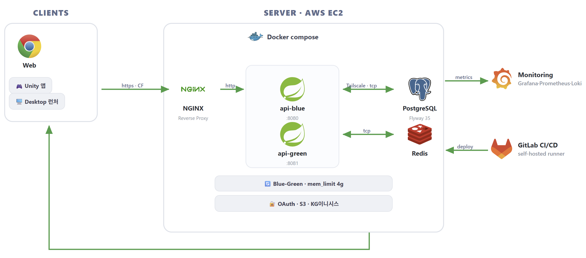

<h1 align="center">📚 DotShelf — 멀티플랫폼 독서 기록 · 가상 책장 서비스</h1>

<p align="center">
  읽은 책을 기록하고 <b>나만의 가상 책장·독서 공간</b>을 꾸미며 공유하는 멀티플랫폼 서비스<br/>
  <em>웹 · Unity(모바일) · 데스크톱 런처 클라이언트가 공통으로 소비하는 Spring Boot REST API</em>
</p>

<p align="center">
  
  
  
  
  
  
</p>

---

## 📌 프로젝트 개요

| 항목 | 내용 |
|:---:|---|
| **기간** | 2026.04 ~ 2026.05 |
| **형태** | 팀 프로젝트 (6인 · 백엔드 2명) · SSAFY 자율 프로젝트 |
| **담당** | **인프라 총괄 + 백엔드 구조 설계** — CI/CD · 무중단 배포 · 서버 운영/보안 · 관찰성 |
| **한줄 소개** | 독서 기록과 가상 책장 꾸미기를 결합한, 웹·모바일·데스크톱 멀티플랫폼 독서 서비스 |

> **인프라 전반**(2-tier 배포 구조 · CI/CD 파이프라인 · Blue-Green 무중단 배포 · 관찰성 스택 · 서버 보안 하드닝)을 혼자 설계·운영했고,
> 백엔드는 **15개 도메인의 계층형 구조와 팀 컨벤션을 정의·문서화**해 BE 2인이 같은 규칙으로 작업하도록 했습니다.
> 도메인 구현은 분담했으며, 제가 직접 구현한 것은 **인증 · 에셋 · 도서 · 책장** 중심입니다. (결제 등 일부 도메인은 다른 팀원 담당)

---

## 🛠️ 기술 스택

| 분류 | 기술 |
|:---:|---|
| **Backend** | Java 21 · Spring Boot 4.0.5 · Spring Security · Spring Data JPA · QueryDSL |
| **Auth** | OAuth 2.0 (Google / Kakao / Apple) · JWT (Access + Refresh Rotation) |
| **Database / Cache** | PostgreSQL 17 · Redis · Flyway(35버전) |
| **Infra / DevOps** | Docker · GitLab CI/CD(self-hosted runner) · Nginx · AWS S3 |
| **운영 / 보안** | Blue-Green 무중단 배포 · Tailscale(app↔db 망 분리) · Cloudflare · JVM 메모리 튜닝 |
| **모니터링** | Prometheus · Grafana · Loki · Promtail |

---

## 🏗️ 인프라 아키텍처 (담당)



- **2-tier 분리**: App 서버 / DB 서버를 분리하고 **Tailscale 사설망**으로 연결해 DB를 외부에 노출하지 않음
- **GitLab CI/CD**: self-hosted runner 기반 빌드 → 테스트 → 이미지 빌드 → 배포 자동화
- **Blue-Green 무중단 배포**로 배포 중 다운타임 제거
- **Cloudflare** 앞단 + Nginx에서 **CF 우회 직접 접근 차단(allowlist)** 보안 가드
- **모니터링 스택**: Prometheus 메트릭 + Grafana 대시보드 + Loki/Promtail 로그 수집

---

## ✨ 핵심 작업

### 🔧 인프라 / DevOps (담당)
- GitLab CI/CD 파이프라인 설계 (멀티 클라이언트 빌드/배포 잡 분리)
- App·DB 2-tier 분리 + Tailscale 망 구성
- Blue-Green 무중단 배포 구축
- JVM 컨테이너 메모리 limit 튜닝, Flyway 자동 마이그레이션 + 헬스체크 연동
- Prometheus/Grafana/Loki/Promtail 관찰성 스택 구축
- 서버 보안 하드닝 (시크릿 권한 600, compose 640, Cloudflare allowlist)

### 📦 백엔드 (BE 2인 협업)
- **구조 설계 (담당)** — Java 21 · Spring Boot 4 기반 15개 도메인의 계층형 구조 정의
- **팀 컨벤션 정의·문서화 (담당)** — [`docs/architecture/patterns.md`](backend/docs/architecture/patterns.md) 353줄 + [`checklist.md`](backend/docs/architecture/checklist.md)
  `ApiResponse<T>` 통일 · Soft Delete(`status` + `deleted_at`) · Cursor 페이징 · Instant(UTC) ·
  에러 코드 도메인 prefix · Repository Custom+Impl 패턴 · N+1 방지 규칙
  → **프로젝트 첫날(2026-04-15)에 작성**해 코드보다 규약을 먼저 세웠습니다
- **직접 구현** — OAuth 소셜 로그인 · 에셋 · 도서 · 책장 도메인
  (독서 기록 · 피드 · 결제 등은 다른 팀원 담당)

---

## 🗄️ 데이터베이스

- **PostgreSQL 17** + **Flyway 35개 마이그레이션** (기존 파일 불변 정책으로 무결성 유지)
- Soft Delete(`status` + `deleted_at`), 시간은 `TIMESTAMP WITH TIME ZONE`(UTC) 통일

---

## 🔧 트러블슈팅 & 기술적 의사결정

<details>
<summary><b>Blue-Green 무중단 배포 구축</b></summary>

> 단일 `api` 컨테이너 배포는 재기동 동안 다운타임이 발생했습니다. `api-blue`(8080)·`api-green`(8081) 두 색을 공존시키고, 배포 시 비활성 색을 먼저 기동→헬스 통과 대기→**prod Nginx의 `upstream.active.conf`를 교체 후 `nginx -s reload`** 로 1~5초 내 graceful cutover하도록 설계했습니다. `deploy-blue-green.sh`가 활성 색 감지→반대 색 기동→스위칭→공개 smoke→2분 유예→구 색 stop까지 오케스트레이션하고, `poll-health.sh`로 전환 구간 health를 폴링해 5xx를 검출합니다.
>
> **실측 (2026-04-23 첫 성공 배포, CI job `#339277`)**
> ```json
> {"duration":30,"attempts":28,"ok":28,"fail":0,"codes":"200:28"}
> ```
> | 지표 | 실측 |
> |---|---|
> | 배포 중 공개 5xx | **0건** (28/28 200) |
> | 색당 컨테이너 메모리 | **471 MiB** (limit 4 GiB의 11.5%) |
> | 롤백 소요 (수동 리허설) | **27초** — 재빌드 없이 구 색 재기동, 45/45 200 |
>
> **한계** — 이 검증은 초당 1회 헬스체크 폴링 기준이라 **in-flight 요청이 있는 상태는 검증하지 못했습니다.**
> Nginx reload는 기존 워커를 graceful하게 종료하므로 이론상 처리 중 요청은 완료되지만,
> k6로 동시 요청을 걸고 재측정해야 확실합니다. 또한 **단일 호스트 제약**이 있어
> 무중단 배포는 애플리케이션 배포 다운타임만 제거하지 호스트 장애는 해결하지 않습니다.
> [`flyway-migration-rules.md`](backend/docs/architecture/flyway-migration-rules.md)의 expand-contract 규약을 어기면
> contract 마이그레이션이 포함된 배포는 롤백 수단으로 작동하지 않습니다.
</details>

<details>
<summary><b>첫 Blue-Green 배포가 2회 연속 실패 — 설계 리뷰에서 안 보이던 두 가지</b></summary>

> 설계와 코드 리뷰를 마치고 실행한 첫 배포가 2회 연속 실패했습니다. **둘 다 코드 로직이 아니라 "실행 환경"** 문제였습니다.
>
> **함정 1 — CI 러너가 자기 자신을 public IP로 호출**
> - 증상: `ssh: connect to host 3.38.240.110 port 22: Operation timed out`
> - 원인: GitLab runner가 **prod 호스트 내부 컨테이너**에서 동작. 자신을 감싼 호스트의 Elastic IP로
>   돌아가려 하자 EC2가 **hairpin NAT**를 막았습니다.
> - 수정: `PROD_HOST`를 docker bridge(`172.17.0.1`)로 변경
> - 방지: [`gitlab-ci-variables.md`](backend/docs/infra/gitlab-ci-variables.md)에 근거를 남기고 배포 체크리스트에 항목 추가
>
> **함정 2 — 자동 로드되는 디렉토리에 명시 `include`를 겹침**
> - 증상: `nginx: [emerg] duplicate upstream "dotshelf_api"`
> - 원인: `nginx.conf`가 이미 `conf.d/*.conf`를 전부 로드하는데 `default.conf`에서
>   `upstream.active.conf`를 다시 `include`해 같은 파일이 두 번 파싱됨
> - 수정: 명시 `include` 제거 + blue/green 템플릿을 `templates/` 서브디렉토리로 이동
>   (서브디렉토리는 `*.conf` 와일드카드에 걸리지 않음)
> - 방지: `conf.d/README.md`에 경고를 남기고, rsync에 `--delete`와 exclude를 걸어
>   과거 오염 파일이 자동 정리되게 함
>
> **배운 것** — "자동 로드 디렉토리 + 명시 include" 조합은 nginx · systemd 등에서 반복되는 함정이고,
> **CI 러너의 물리적 위치는 설계 변수**입니다. 설계 시점에는 보이지 않고 첫 실행에서만 드러나는
> 종류의 문제라, 이후로는 신규 인프라를 도입할 때 **수동 리허설을 먼저 하고 자동화하는 순서**로 바꿨습니다.
>
> 상세: [`docs/infra/2026-04-23-blue-green.md` §7-bis](backend/docs/infra/2026-04-23-blue-green.md)
</details>

<details>
<summary><b>헤더 한 줄로 남의 계정 행세가 가능하던 인증 구조 교체</b></summary>

> `SecurityConfig`가 전 요청을 허용하고 `ArgumentResolver`가 `X-User-Id` 헤더를 그대로 신뢰해,
> **헤더 한 줄이면 남의 계정으로 접근**할 수 있는 상태였습니다.
> 토큰을 발급하는 쪽만 있고 요청에서 검증하는 필터가 없어 인증 체인이 끊겨 있었습니다.
> 초기 도메인 골격을 세울 때 개발 편의로 넣은 헤더 주입이 인증 구현 전까지 남아 있던 것이고,
> **같은 날 아키텍처 리뷰를 돌리다 발견해 즉시 교체**했습니다(둘 다 2026-04-21).
>
> `JwtAuthenticationFilter`로 Bearer 토큰을 검증해 `SecurityContext`에 `Principal`을 등록하고,
> `ArgumentResolver`가 헤더 대신 `Principal`에서 `userId`를 꺼내도록 바꿨습니다.
> 이제 `userId`는 **서버가 서명 검증한 토큰에서만** 나옵니다.
>
> 비공개 API 10개에 대해 **토큰 없음 · 헤더 위조 20건을 실측해 전부 401 차단**을 확인했고,
> 회귀 방지 테스트 4건(`AuthBypassProbeTest`)을 남겼습니다.
</details>

<details>
<summary><b>JVM heap이 컨테이너가 아닌 호스트 기준으로 잡혀 OOM 위험 — 사전 차단</b></summary>

> `-XX:+UseContainerSupport -XX:MaxRAMPercentage=60`은 **컨테이너 메모리 제한의 60%**를 heap max로 잡습니다. 그런데 compose에 `mem_limit`이 없어 컨테이너 제한이 **호스트 전체(15GiB)** 로 취급 → heap이 최대 ~9GiB까지 커질 수 있었습니다. Blue-Green으로 두 색이 공존하면 **2×9 = 18GiB > 15GiB → OOM** 가능. `mem_limit: 4g`를 명시해 컨테이너 기준으로 heap을 제한, Blue-Green 도입의 선행 조건으로 처리했습니다.
</details>

<details>
<summary><b>App/DB 2-tier 분리 + Tailscale 사설망 — 휘발성 서버 트레이드오프</b></summary>

> 추가 지급된 SSAFY 서버(자원 넉넉하나 학기말 소멸)와 기존 영속 서버를 두고, **"변하면 안 되는 것(DB·DNS·TLS)은 오래 사는 서버에, 교체 가능한 앱은 휘발성 서버에"** 원칙으로 App(SSAFY)·DB(prod) 2-tier로 분리했습니다. 두 서버 간 DB/Redis 트래픽은 공용 인터넷에 노출하지 않기 위해 AWS Security Group IP 화이트리스트 대신 **Tailscale(WireGuard) VPN**을 채택 — IP 변동 내성·로컬 DB 접근 커버·무료 티어를 근거로 결정하고, PostgreSQL/Redis를 **Tailscale IP에만 bind**해 외부 접근을 차단했습니다.
</details>

<details>
<summary><b>관찰성 스택 — Blue-Green 색별 메트릭 관측</b></summary>

> Prometheus + Grafana + Loki + Promtail로 관찰성을 구축하고, `...by (color)` 쿼리로 **blue/green 색별 RPS·지연·에러·JVM heap**을 한 화면에서 분리 관측해 배포 전환을 가시화했습니다. Grafana는 외부 미노출(SSH 터널만), 공개 Nginx에서 `/actuator`는 404로 차단.
</details>

<details>
<summary><b>(운영) CI 배포가 prod 파일 권한을 666으로 되돌리던 문제</b></summary>

> 보안 하드닝으로 `docker-compose.yml`을 640으로 바꿔도 CI가 돌면 **666(world-writable)** 으로 회귀했습니다. 원인은 `rsync -az`의 `-a`가 소스 권한을 보존해 dest를 덮어쓴 것. 5개 deploy 잡에 rsync 직후 `chmod 640`을 추가해 **멱등하게 고정**했습니다. (수동 패치는 CI에 흡수되지 않으면 반드시 회귀한다는 교훈)
</details>
